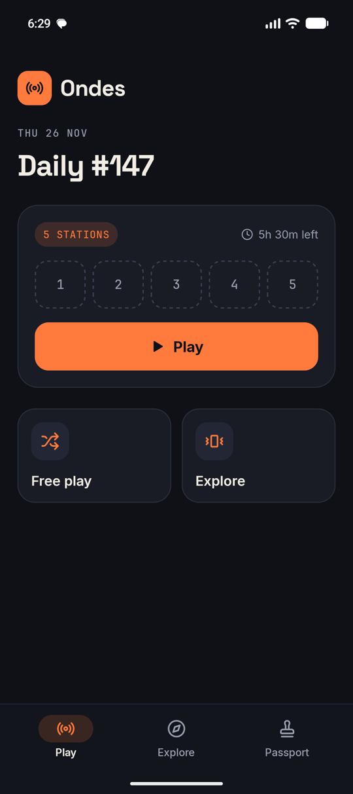
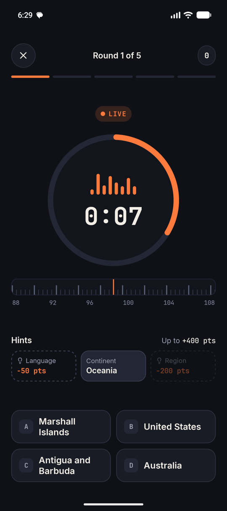
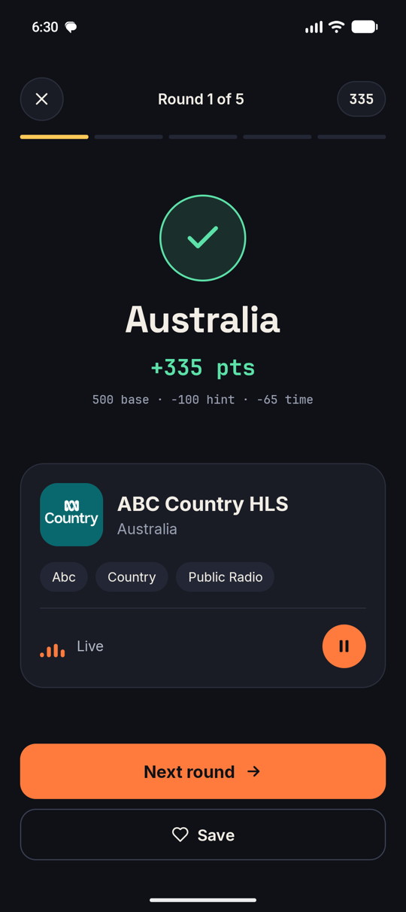
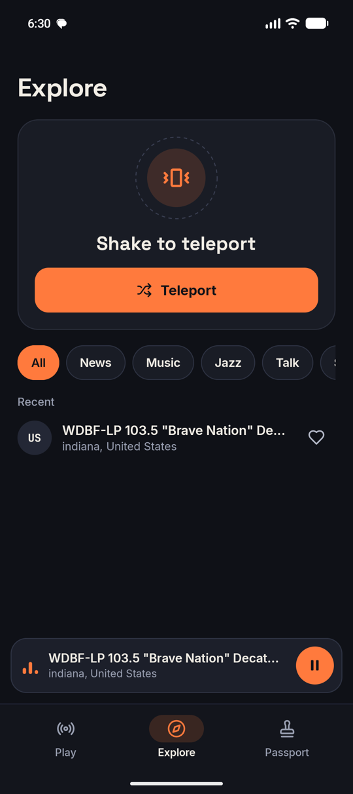
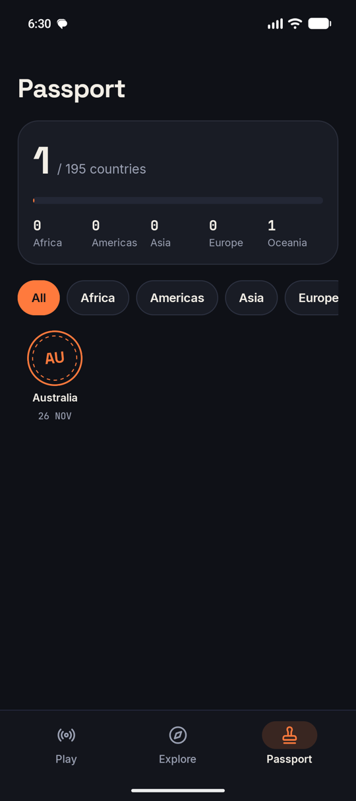

# Ondes

A geography game played by ear, for Android. It plays a radio station that is live somewhere in the world, and you guess the country.

<p>
  
  
  
  
  
</p>

## Features

- Daily challenge: the same 5 stations for every player, every day, with a streak
- Free play with random stations
- Hints for the language, the continent and the region, each for a few points
- Explore: shake the phone to jump to a random live station
- Passport: a stamp for every country you guess right
- Share your daily score as a line of colored squares
- English and French, following the phone's language or the app's own language setting on Android 13+

## Download

The signed APK is on the [Releases](https://github.com/SectionTN/ondes/releases) page.

Requirements:

- Android 7.0 (API 24) or newer
- An internet connection to play. Home and Passport open offline.

## Scoring

The app plays a station for 20 seconds and you pick one of four countries. The timer only runs while you hear sound.

| Rule | Points |
| --- | --- |
| A right answer starts at 500 points. | 500 |
| Each second you listen costs 5 points. | -5 per second |
| The Language hint costs 50 points. | -50 |
| The Continent hint costs 100 points. | -100 |
| The Region hint costs 200 points. | -200 |
| A wrong answer or the end of the timer gives 0 points. | 0 |

## Architecture

Java and XML layouts, one activity per flow, and a ViewModel per screen group:

| Package | What it holds |
| --- | --- |
| `ui` | Holds the activities, the fragments, their ViewModels and the custom views. |
| `game` | Holds the game rules: scoring, the daily seed, the wrong answers and the streak. They are plain Java with unit tests. |
| `player` | Holds `RadioPlayer`, the one ExoPlayer the whole app shares. |
| `data/api` | Calls Radio Browser with Retrofit and moves to another server when one fails. |
| `data/db` | Stores stamps, recent and saved stations and daily results with Room. |
| `data/countries` | Reads the 195 countries from `assets/countries.json`. |

The daily works without a server. The day number picks the five countries, and a SHA-256 hash of the day and each station ID puts the stations in order. Every phone then plays the same stations.

The app allows plain `http` traffic in `network_security_config.xml`. Many stations in Radio Browser only stream over `http`.

## Build

Build a debug APK and run the unit tests:

```sh
./gradlew assembleDebug testDebugUnitTest
```

Requirements:

- Android Studio with JDK 17 or newer

A signed release build reads `keystore.properties` at the project root, which git ignores:

```properties
storeFile=/path/to/ondes-release.jks
storePassword=...
keyAlias=ondes
keyPassword=...
```

Build it:

```sh
./gradlew assembleRelease
```

The APK is in `app/build/outputs/apk/release/`. Without `keystore.properties` the release build is unsigned.

## Credits

- Station directory: [Radio Browser](https://www.radio-browser.info)
- Country data: [mledoze/countries](https://github.com/mledoze/countries), under the Open Database License
- Fonts: Space Grotesk, Inter and JetBrains Mono, under the SIL Open Font License
- Icons: [Lucide](https://lucide.dev), under the ISC License

---

<p align="center">Made by <a href="https://github.com/SectionTN">SectionTN</a></p>
